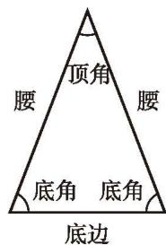

等腰三角形（如图 5-10）是比较常见的图形。你有哪些办法可以得到一个等腰三角形？与同伴进行交流。

> [!question] 思考·交流
> 
>
> (1) 等腰三角形是轴对称图形吗? 如果是, 沿它的对称轴折叠, 你能发现哪些相等的线段和相等的角?
>
> 图5-10
>
> （2）等腰三角形的对称轴是一条怎样的直线？你是如何描述的？
>
> (3) 你认为等腰三角形有哪些特征？与同伴进行交流。
