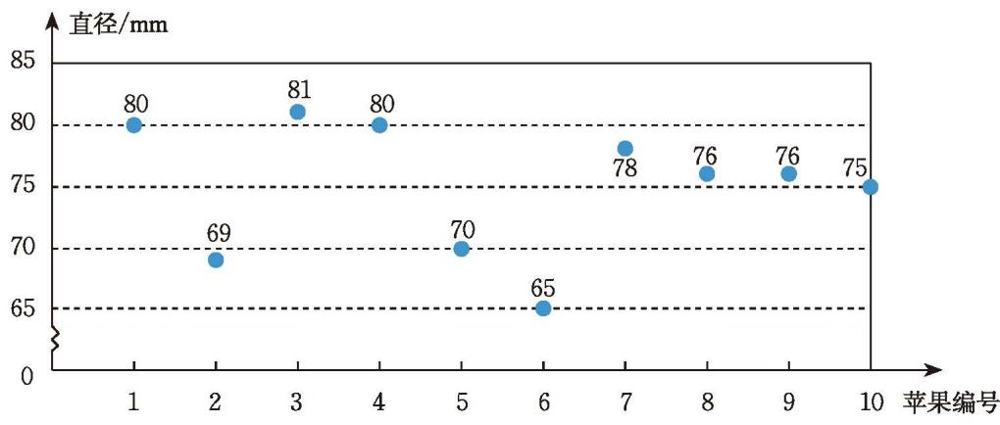

> [!question] 思考·交流
> 10 个苹果的直径如图 6-6 所示。
>
> 
> 图6-6
>
> (1) 若想把这 10 个苹果分成两组, 使每组苹果的 “个头” 差不多, 你想怎么分? 说说你分组的理由。
>
> (2) 一般情况下, 如果想把一组数据分成若干组, 使每组组内的数据差距不大, 且组与组之间的数据差别明显, 那么你认为应遵循怎样的分组原则? 与同伴进行交流。
