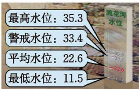
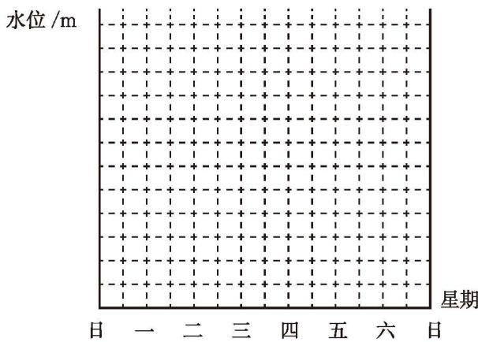

**思考·交流**
图 2-9 呈现了流花河的水位情况（单位：m），取河流的警戒水位作为 0 点，那么图中的其他数据可以分别记作什么？

下表是某年雨季流花河一星期内的水位变化情况（正号表示水位比前一天上升，负号表示水位比前一天下降；上星期日的水位达到警戒水位）。

图2-9

<table><tr><td>星期</td><td>一</td><td>二</td><td>三</td><td>四</td><td>五</td><td>六</td><td>日</td></tr><tr><td>水位变化/m</td><td>+0.20</td><td>+0.81</td><td>-0.35</td><td>+0.03</td><td>+0.28</td><td>-0.36</td><td>-0.01</td></tr></table>

(1) 本星期哪一天河流的水位最高? 哪一天河流的水位最低? 它们位于警戒水位之上还是之下? 到警戒水位的距离分别是多少米?

(2) 与上星期日相比, 本星期日河流水位是上升了还是下降了?

(3) 完成本星期水位记录表:

<table><tr><td>星期</td><td>一</td><td>二</td><td>三</td><td>四</td><td>五</td><td>六</td><td>日</td></tr><tr><td>水位记录/m</td><td>33.60</td><td></td><td></td><td></td><td></td><td></td><td></td></tr></table>

(4) 以警戒水位为 0 点, 在图 2-10 中画折线表示本星期的水位情况。

图2-10

(5) 你还能提出什么数学问题？与同伴进行交流。
