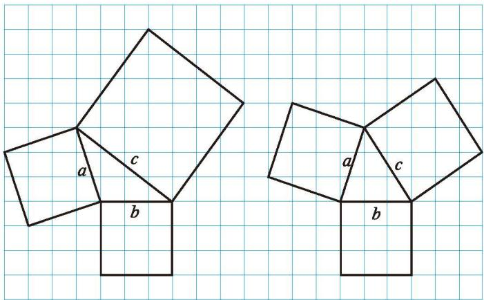

# 思考·交流：生活与数学中勾股定理的应用实例

## 北师大版初中数学·八年级上册

> [!question] 思考·交流
> 如果一个三角形是钝角三角形或锐角三角形，那么它的三边长仍然满足“最长边长的平方等于另外两边长的平方和”吗？以图1-10为例（方格纸中每个小方格的边长均为1），说说你的判断和理由，并与同伴进行交流。
>
> 
> 图1-10
>
> 也可以用数学软件验证你的判断。

