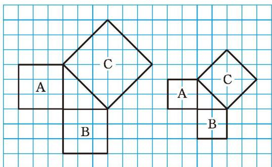
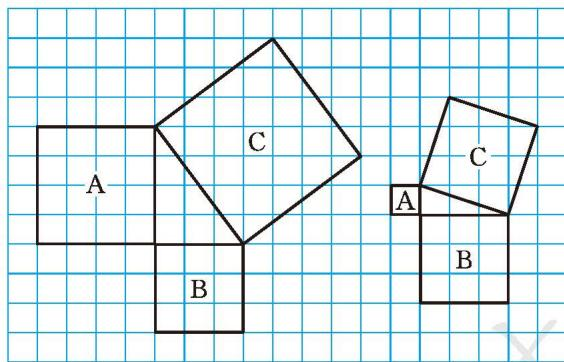

> [!question] 思考·交流
> (1) 在纸上画若干个直角三角形, 分别测量它们的三条边, 看看三条边长度的平方之间有怎样的关系。与同伴进行交流。
>
> (2) 如图 1-2[^1], 方格纸中每个小方格的边长均为 1 , 直角三角形三条边长度的平方分别是多少, 它们满足上面所猜想的数量关系吗? 如果直角三角形如图 1-3 所示, 结果又如何? 你是怎样计算的? 与同伴进行交流。
>
> (3) 如果直角三角形的两条直角边的长度分别是 1.6 和 2.4, 那么上面所猜想的数量关系还成立吗? 说说你的理由。
>
> 
> 图1-2
>
> 
> 图1-3
>
> [^1]: 如无特别说明，本书中方格纸上图形的顶点都在格点上。
