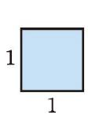
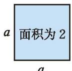
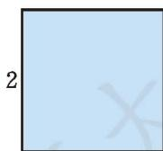

# 思考·交流：逐步逼近估算面积为2的正方形边长a

## 北师大版初中数学·八年级上册

> [!question] 思考·交流
> 面积为 2 的正方形的边长 a 究竟是多少呢?
>
> (1) 如图 2-3, 三个正方形的边长之间有怎样的大小关系? 说说你的理由。
>
> (2) 边长 $a$ 的整数部分是几？十分位是几？百分位呢？千分位呢？……借助计算器进行探索。
>
> (3) 小明将他的探索过程整理如下:
>
> 
>
> 
> 图2-3
>
> 
>
> 2
>
> <table><tr><td>边长a</td><td>面积S</td></tr><tr><td>1 &lt; a &lt; 2</td><td>1 &lt; S &lt; 4</td></tr><tr><td>1.4 &lt; a &lt; 1.5</td><td>1.96 &lt; S &lt; 2.25</td></tr><tr><td>1.41 &lt; a &lt; 1.42</td><td>1.988 1 &lt; S &lt; 2.016 4</td></tr><tr><td>1.414 &lt; a &lt; 1.415</td><td>1.999 396 &lt; S &lt; 2.002 225</td></tr><tr><td>1.414 2 &lt; a &lt; 1.414 3</td><td>1.999 961 64 &lt; S &lt; 2.000 244 49</td></tr></table>
>
> 还可以继续算下去吗？ $a$ 可能是有限小数吗？
>
> (4) 面积为 5 的正方形的边长 $b$ 的值是多少? $b$ 可能是有限小数吗? 与同伴进行交流。

