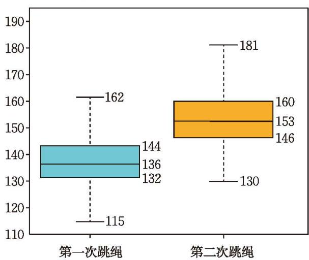

# 思考·交流：通过两次跳绳箱线图（图6-11）比较整体变化与箱线图特点

## 北师大版初中数学·八年级上册

> [!question] 思考·交流
> (1) 图 6-11 是同一班级学生两次 $1 \mathrm{~min}$ 跳绳成绩的箱线图。该班学生第二次跳绳成绩有什么变化？你是如何得出结论的？
>
> (2) 你认为箱线图在表示数据方面有什么特点？与同伴进行交流。
>
> 
> 图6-11
>

