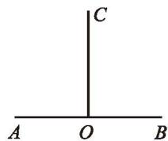

# 思考·交流：邻补角相等判定垂直与垂直互推说理

## 北师大版初中数学·七年级下册

> [!question] 思考·交流
> 如图 2-8, O 为直线 AB 上的一点。
>
> (1) 如果 $\angle AOC = \angle BOC$ , 那么 $OC$ 与 $AB$ 垂直吗? 为什么?
>
> 
>
> (2) 以下是小颖的思考过程, 她的想法正确吗? 你知道她每一步的依据吗? 与同伴进行交流。
>
> 图2-8
>
> 
>
> 我是这样思考的：
> 由 $\angle AOC = \angle BOC$ ，且 $\angle AOC + \angle BOC = 180^{\circ}$ ，
> 可得 $\angle AOC = \angle BOC = 90^{\circ}$ ,
> 所以 $OC \perp AB$ 。
>
> (3) 如果 $OC \perp AB$ , 那么 $\angle AOC = \angle BOC$ 吗? 为什么? 与同伴进行交流。

