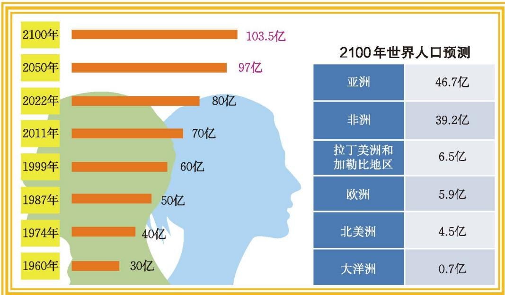
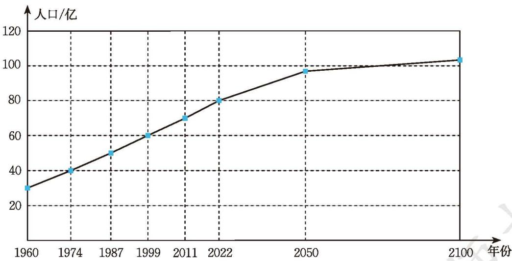
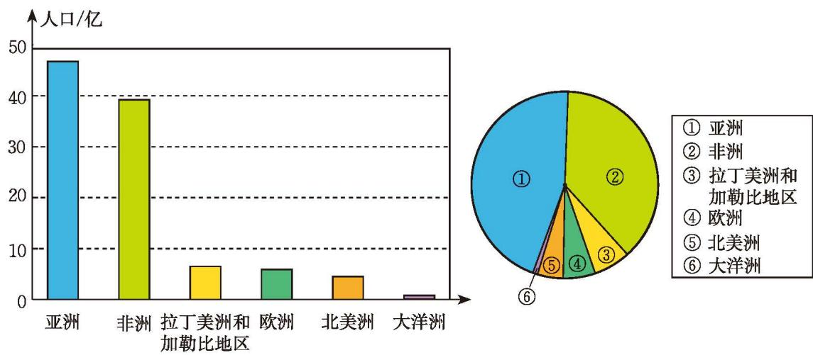

# 情境探究：结合世界人口预测数据比较三种统计图

## 北师大版初中数学·七年级上册

图 6-13 呈现了世界人口情况及预测数据。

图6-13

小亮据此绘制了下面的统计图（如图 6-14、图 6-15、图 6-16）。

图6-14

图6-15

图6-16
根据小亮绘制的统计图，回答下列问题：
(1) 三幅统计图分别表示什么内容?
(2) 从哪幅统计图中你能看出世界人口的变化情况?

(3) 预计 2100 年非洲人口大约将达到多少亿? 你是从哪幅统计图中得到这个数据的?

(4) 预计 2100 年亚洲人口比拉丁美洲和加勒比地区、欧洲、北美洲、大洋洲的人口总和还要多, 你从哪幅统计图中可以明显地得到这个结论?

(5) 比较三种统计图的特点, 并与同伴进行交流。

