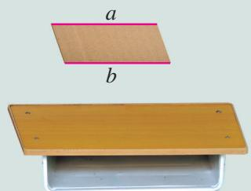
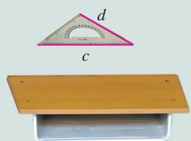

探究

根据基本事实的推论2，3，过两条平行直线或两条相交直线，有且只有一个平面。由此可以想到，如果一个平面内有两条平行或相交的直线都与另一个平面平行，是否就能使这两个平面平行？

我们可以借助以下两个实例进行观察．如图8.5-11(1)，a和b分别是矩形硬纸片的两条对边所在直线，它们都和桌面平行，那么硬纸片和桌面平行吗？如图8.5-11(2)，c和d分别是三角尺相邻两边所在直线，它们都和桌面平行，那么三角尺和桌面平行吗？

  
(1)

  
图8.5-11  
(2)
