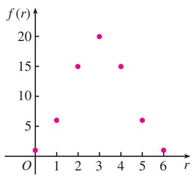

探究

用计算工具计算 $(a + b)^n$ 的展开式的二项式系数，并填入表6.3-1.

表6.3-1

<table><tr><td>n</td><td colspan="8"> $(a+b)^{n}$ 的展开式的二项式系数</td></tr><tr><td>1</td><td></td><td></td><td></td><td></td><td></td><td></td><td></td><td></td></tr><tr><td>2</td><td></td><td></td><td></td><td></td><td></td><td></td><td></td><td></td></tr><tr><td>n</td><td colspan="8"> $(a+b)^n$ 的展开式的二项式系数</td></tr><tr><td>3</td><td></td><td></td><td></td><td></td><td></td><td></td><td></td><td></td></tr><tr><td>4</td><td></td><td></td><td></td><td></td><td></td><td></td><td></td><td></td></tr><tr><td>5</td><td></td><td></td><td></td><td></td><td></td><td></td><td></td><td></td></tr><tr><td>6</td><td></td><td></td><td></td><td></td><td></td><td></td><td></td><td></td></tr></table>

通过计算、填表，你发现了什么规律？

从表 6.3-1 可以发现，每一行中的系数具有对称性。除此以外还有什么规律呢？为了便于发现规律，上表还可以写成如图 6.3-1 所示的形式。

<table><tr><td> $(a+b)^{1}$ </td><td>1</td><td>1</td><td></td><td></td><td></td><td></td></tr><tr><td> $(a+b)^{2}$ </td><td>1</td><td>2</td><td>1</td><td></td><td></td><td></td></tr><tr><td> $(a+b)^{3}$ </td><td>1</td><td>3</td><td>3</td><td>1</td><td></td><td></td></tr><tr><td> $(a+b)^{4}$ </td><td>1</td><td>4</td><td>6</td><td>4</td><td>1</td><td></td></tr><tr><td> $(a+b)^{5}$ </td><td>1</td><td>5</td><td>10</td><td>10</td><td>5</td><td>1</td></tr><tr><td> $(a+b)^{6}$ </td><td>1</td><td>6</td><td>15</td><td>20</td><td>15</td><td>6</td></tr></table>

图6.3-1

表示形式的变化常常能帮助我们发现某些规律.

观察图6.3-1，你还能发现哪些规律？

对于 $(a + b)^n$ 的展开式的二项式系数

$$
\mathrm{C} _ {n} ^ {0}, \mathrm{C} _ {n} ^ {1}, \mathrm{C} _ {n} ^ {2}, \dots , \mathrm{C} _ {n} ^ {n},
$$

我们还可以从函数的角度分析它们. $\mathrm{C}_n^r$ 可看成以 $r$ 为自变量的函数 $f(r)$ ，其定义域是

$$
\{0, 1, 2, \dots , n \}.
$$

对于确定的 $n$ ，我们还可以画出它的图象。例如，当 $n = 6$ 时，函数 $f(r) = \mathrm{C}_n^r (r \in \{0, 1, 2, 3, 4, 5, 6\})$ 的图象是7个离散点，如图6.3-2所示。

  
图6.3-2

