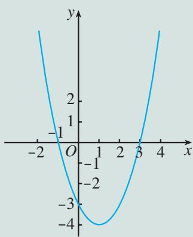

探究

对于二次函数 $f(x) = x^{2} - 2x - 3$ ，观察它的图象（图4.5-1），发现它在区间 $[2, 4]$ 上有零点。这时，函数图象与 $x$ 轴有什么关系？在区间 $[-2, 0]$ 上是否也有这种关系？你认为应如何利用函数 $f(x)$ 的取值规律来刻画这种关系？

再任意画几个函数的图象，观察函数零点所在区间，以及这一区间内函数图象与 $x$ 轴的关系，并探究用 $f(x)$ 的取值刻画这种关系的方法.

  
图4.5-1
