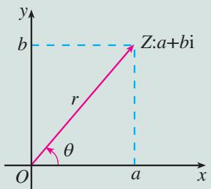

我们知道，复数可以用 $a + bi(a, b \in \mathbf{R})$ 的形式来表示，复数 $a + bi$ 与复平面内的点 $Z(a, b)$ 是一一对应的，与平面向量 $\overrightarrow{OZ} = (a, b)$ 也是一一对应的。借助复数的几何意义，复数能不能用其他形式来表示呢？

探究

如图 7.3-1，复数 $z=a+bi$ 与向量 $\overrightarrow{OZ}=(a,b)$ ——对应，复数 z 由向量 $\overrightarrow{OZ}$ 的坐标 $(a,b)$ 唯一确定。我们知道向量也可以由它的大小和方向唯一确定，那么能否借助向量的大小和方向这两个要素来表示复数呢？如何表示？

  
图7.3-1
