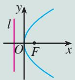
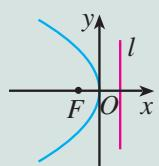
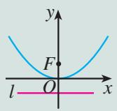
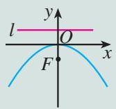

探究

在建立椭圆、双曲线的标准方程时，选择不同的坐标系我们得到了不同形式的标准方程。抛物线的标准方程有哪些不同的形式？请探究之后填写下表。

<table><tr><td>图形</td><td>标准方程</td><td>焦点坐标</td><td>准线方程</td></tr><tr><td></td><td> $y^{2}=2px (p>0)$ </td><td> $\left(\frac{p}{2}, 0\right)$ </td><td> $x=-\frac{p}{2}$ </td></tr><tr><td></td><td></td><td></td><td></td></tr><tr><td></td><td></td><td></td><td></td></tr><tr><td></td><td></td><td></td><td></td></tr></table>
