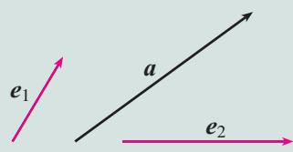
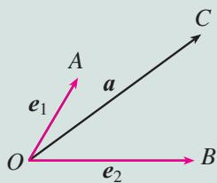

探究

如图 6.3-2（1），设 $e_{1}$ ， $e_{2}$ 是同一平面内两个不共线的向量，a 是这一平面内与 $e_{1}$ ， $e_{2}$ 都不共线的向量。如图 6.3-2（2），在平面内任取一点 O，作 $\overrightarrow{OA}=e_{1}$ ， $\overrightarrow{OB}=e_{2}$ ， $\overrightarrow{OC}=a$ 。将 a 按 $e_{1}$ ， $e_{2}$ 的方向分解，你有什么发现？

(1)  

  
图6.3-2  
(2)
