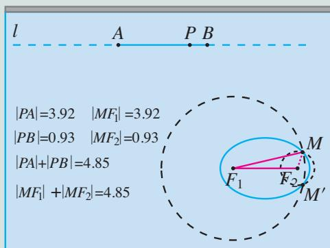
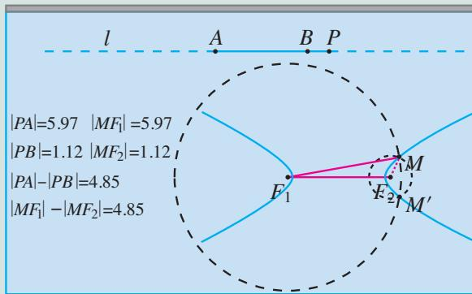

探究

如图3.2-1，在直线 $l$ 上取两个定点 $A, B, P$ 是直线 $l$ 上的动点。在平面内，取定点 $F_{1}, F_{2}$ ，以点 $F_{1}$ 为圆心、线段 $PA$ 为半径作圆，再以 $F_{2}$ 为圆心、线段 $PB$ 为半径作圆。

我们知道，当点 $P$ 在线段 $AB$ 上运动时，如果 $\left| |PA| - |PB| \right| \leqslant \left| F_1F_2 \right| < |AB|$ ，那么两圆交点的轨迹是椭圆.

  
图3.2-1

  
图3.2-2

如图3.2-2，在 $|AB| < |F_{1}F_{2}| \leqslant |PA| + |PB|$ 的条件下，让点 $P$ 在线段 $AB$ 外运动，这时动点 $M$ 满足什么几何条件？两圆交点的轨迹是什么形状？
