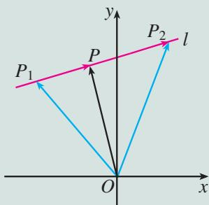

# 探究-用向量求线段中点坐标

## 高中必修 第二册·人教A版数学

探究

如图6.3-18，线段 $P_{1}P_{2}$ 的端点 $P_{1}$ ， $P_{2}$ 的坐标分别是 $(x_{1}, y_{1})$ ， $(x_{2}, y_{2})$ ，点 $P$ 是直线 $P_{1}P_{2}$ 上的一点。当 $\overrightarrow{P_1P} = \lambda \overrightarrow{PP_2}$ 时，点 $P$ 的坐标是什么？

  
图6.3-18

