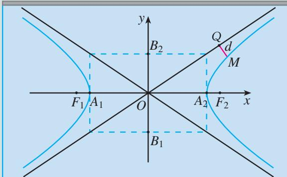

探究

利用信息技术画出双曲线 $\frac{x^2}{9} -\frac{y^2}{4} = 1$ 和两条直线 $\frac{x}{3}\pm \frac{y}{2} = 0$ （图3.2-9）．在双曲线 $\frac{x^2}{9} - \frac{y^2}{4} = 1$ 的右支上取一点 $M$ ，测量点 $M$ 的横坐标 $x_M$ 以及它到直线 $\frac{x}{3} - \frac{y}{2} = 0$ 的距离 $d$ 。沿曲线向右上方拖动点 $M$ ，观察 $x_M$ 与 $d$ 的大小关系，你发现了什么？

  
图3.2-9
