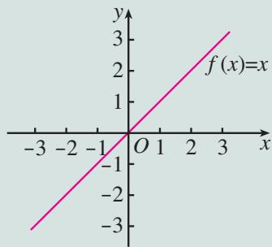
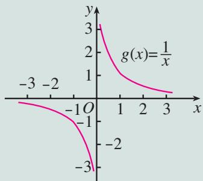

探究

观察函数 $f(x) = x$ 和 $g(x) = \frac{1}{x}$ 的图象（图3.2-8），你能发现这两个函数图象有什么共同特征吗？你能用符号语言精确地描述这一特征吗？

  
图3.2-8

不妨取自变量的一些特殊值，看相应函数值的情况，请完成表3.2-2。

表3.2-2

<table><tr><td>x</td><td>...</td><td>-3</td><td>-2</td><td>-1</td><td>0</td><td>1</td><td>2</td><td>3</td><td>...</td></tr><tr><td>f(x)=x</td><td>...</td><td></td><td></td><td></td><td></td><td></td><td></td><td></td><td>...</td></tr><tr><td>g(x)= $\frac{1}{x}$ </td><td>...</td><td></td><td></td><td></td><td></td><td></td><td></td><td></td><td>...</td></tr></table>
