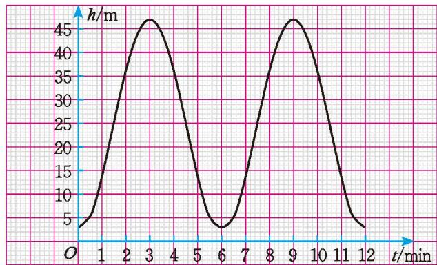

# 摩天轮高度随时间变化函数背景引入（图4-1）

## 北师大版初中数学·八年级上册

你坐过摩天轮吗？想一想，如果你坐在摩天轮上，随着时间的变化，你离地面的高度是如何变化的？

图 4-1 反映了一个摩天轮上某一点离地面的高度 h（单位：m）与旋转时间 t（单位：min）之间的关系。

图4-1

(1) 根据图 4-1 填写下表。

<table><tr><td>t/min</td><td>0</td><td>1</td><td>2</td><td>3</td><td>4</td><td>5</td><td>...</td></tr><tr><td>h/m</td><td></td><td></td><td></td><td></td><td></td><td></td><td>...</td></tr></table>

(2) 对于给定的时间 $t$ , 相应的高度 $h$ 确定吗?

