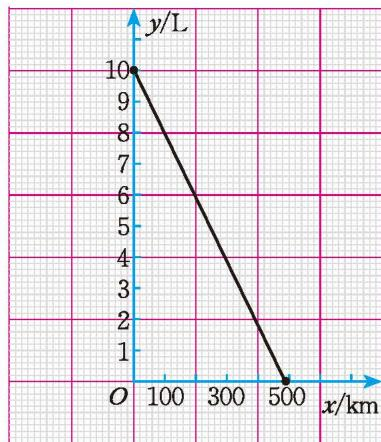

# 摩托车剩余油量与行驶路程一次函数图象分析（图4-8）

## 北师大版初中数学·八年级上册

某辆摩托车的油箱加满油后，油箱中的剩余油量 $y$ （单位：L）与该摩托车行驶路程 $x$ （单位：km）之间的关系如图4-8所示。根据图象回答下列问题：

(1) 油箱最多可储油多少升?

(2) 一箱油可供该摩托车行驶多少千米?

(3) 该摩托车每行驶 $100 \mathrm{~km}$ 消耗多少升油?

(4) 油箱中的剩余油量小于 $1 \mathrm{~L}$ 时, 该摩托车将自动报警。加满油行驶多少千米后, 该摩托车将自动报警?

图4-8

