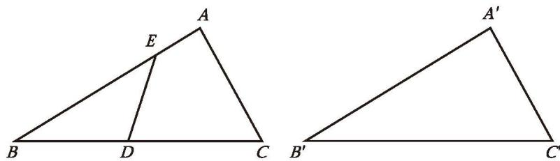

# 操作·交流：全等三角形对应高、中线、角平分线探索

## 北师大版初中数学·七年级下册

> [!question] 操作·交流
> (1) 每人准备两张全等三角形纸片, 并画出两张三角形纸片对应边的高。 全等三角形对应边的高相等吗? 对应边的中线呢? 对应的角平分线呢?
>
> (2)如图4-20,已知 $\triangle ABC \cong \triangle A'B'C'$ , 点 $D$ , $E$ 分别在 $BC$ 边、 $AB$ 边上, 请在 $\triangle A'B'C'$ 中画出与线段 $DE$ 相对应的线段。图中有哪些相等的线段、相等
>
> 的角？与同伴进行交流。
>
> 
> 图4-20
>

