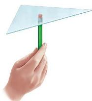

> [!question] 操作·交流
> (1) 在纸上画一个锐角三角形, 并画出它的三条中线, 它们有怎样的位置关系? 与同伴进行交流。
>
> (2) 钝角三角形和直角三角形的三条中线也有同样的位置关系吗? 画一画, 折一折, 并与同伴进行交流。
>
> 也可以利用数学软件探索任意三角形三条中线的位置关系。
>
> 
> 图4-18
>
> (3) 如图 4-18, 用铅笔可以支起一张质地均匀的三角形卡片, 怎样确定这个点的位置呢?
