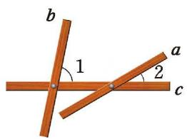
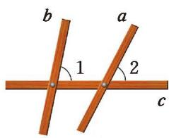
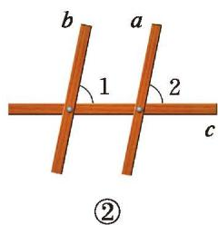
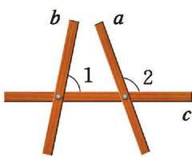

> [!question] 操作·交流
> (1) 如图 2-15, 三根木条相交成 $\angle 1, \angle 2$ , 固定木条 $b, c$ , 转动木条 $a$ 。如图 2-16, 在转动木条 $a$ 的过程中, 观察 $\angle 2$ 的变化以及它与 $\angle 1$ 的大小关系, 你发现木条 $a$ 与木条 $b$ 的位置关系发生了什么变化? 木条 $a$ 何时与木条 $b$ 平行? 与同伴进行交流。
>
> 
> 图2-15
>
> 
>
> ①
>
> 
> 图2-16
>
> 
>
> ③
>
> (2) 改变图 2-15 中 $\angle 1$ 的大小, 按照 (1) 中的方式再做一做。 $\angle 1$ 与 $\angle 2$ 的大小满足什么关系时, 木条 $a$ 与木条 $b$ 平行? 与同伴进行交流。
