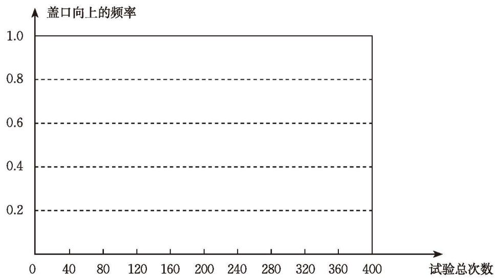

# 操作·思考（2）—（4）：全班累计抛瓶盖频率变化规律探究

## 北师大版初中数学·七年级下册

(2) 累计全班同学的试验结果, 并将试验数据汇总填入下表。

<table><tr><td>试验总次数n</td><td>40</td><td>80</td><td>120</td><td>160</td><td>200</td><td>240</td><td>280</td><td>320</td><td>360</td><td>400</td></tr><tr><td>盖口向上的次数m</td><td></td><td></td><td></td><td></td><td></td><td></td><td></td><td></td><td></td><td></td></tr><tr><td>盖口向上的频率 $\frac{m}{n}$ </td><td></td><td></td><td></td><td></td><td></td><td></td><td></td><td></td><td></td><td></td></tr></table>

(3) 根据表格, 完成图 3-3 的折线统计图。

图3-3

(4) 观察图 3-3 的折线统计图, 盖口向上的频率的变化有什么规律?

