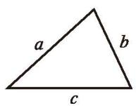
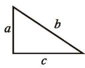
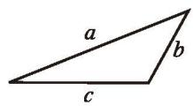
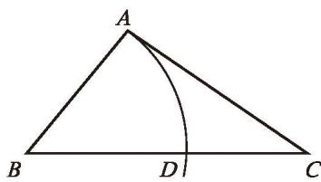

# 操作·思考：测量边长并用圆规探究三角形两边之差

## 北师大版初中数学·七年级下册

> [!question] 操作·思考
> 1. 分别量出图 4-12 中三个三角形的三边长度，并填入空格内。
>
> 
> (1)
>
> 
> (2)
>
> 图4-12
>
> 
> (3)
>
> (1) $a = \_$ ,
> (2) $a = \_$ ,
> (3) $a = \_$ , $b = \_$ , $b = \_$ , $c = \_$ ; $c = \_$ ; $c = \_$ .
>
> 计算每个三角形的任意两边之差，并与第三边比较，你能得到什么结论？再画一些三角形试一试。
>
> 2. 如图 4-13, 在 $\triangle ABC$ 中, 以点 $B$ 为圆心, 以 $BA$ 的长为半径作弧, 与边 $BC$ 交于点 $D$ , 图中是否有线段长度等于 $BC - AB$ 呢? 能用圆规直观说明 $BC - AB$ 与 $AC$ 之间的大小关系吗? 改变三角形的形状再试试看, 你能得到什么结论?
>
> 
> 图4-13
>

