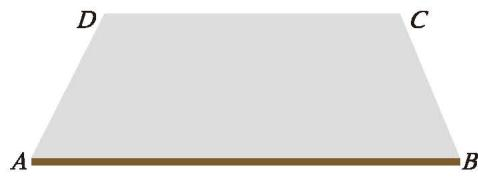

装修工人李叔叔想检测某块装修用砖（如图 1-16）的边 AD 和边 BC 是否分别垂直于边 AB。

（1）如果李叔叔随身只带了卷尺，那么你能替他想办法完成任务吗？

图1-16

(2) 李叔叔测得边 $AD$ 长 $30 \mathrm{~cm}$ , 边 $AB$ 长 $40 \mathrm{~cm}$ , 点 $B$ , $D$ 之间的距离是 $50 \mathrm{~cm}$ 。边 $AD$ 垂直于边 $AB$ 吗?

(3) 如果李叔叔随身只带了一把长度为 $20 \mathrm{~cm}$ 的刻度尺, 那么他能检验边 $A D$ 是否垂直于边 $A B$ 吗?
