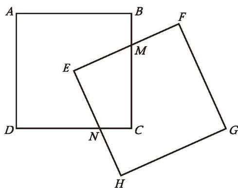

问题 如图 4-34，有两个边长为 1 的正方形，其中正方形 EFGH 的顶点 E 与正方形 ABCD 的中心重合。在正方形 EFGH 绕点 E 旋转的过程中，两个正方形重叠部分的面积是多少？

(1) 在旋转过程中, 两个正方形的重叠部分会呈现出哪些情形?

图4-34

(2) 对于这些不同情形, 如何求两个正方形重叠部分的面积? 你遇到的困难是什么?

(1) 哪些特殊情形下, 两个正方形重叠部分的面积容易求出?

(2) 其他情形能转化为容易求解的特殊情形吗?

写出你的解决方案，并说明道理。
