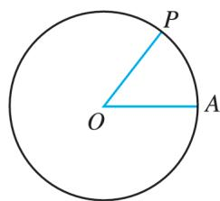

  
图5.2-1

在弧度制下，我们已经将角的范围扩展到全体实数。下面借助这些知识研究上一节开头提出的问题。不失一般性，先研究单位圆上点的运动。现在的任务是：

如图 5.2-1，单位圆 $\odot O$ 上的点 P 以 A 为起点做逆时针方向旋转，建立一个数学模型，刻画点 P 的位置变化情况.

## 引出的知识

- [任意角的三角函数定义与定义域](../%E7%9F%A5%E8%AF%86%E7%82%B9/%E7%9F%A5%E8%AF%86%E7%82%B9-%E4%BB%BB%E6%84%8F%E8%A7%92%E7%9A%84%E4%B8%89%E8%A7%92%E5%87%BD%E6%95%B0%E5%AE%9A%E4%B9%89%E4%B8%8E%E5%AE%9A%E4%B9%89%E5%9F%9F.md)
