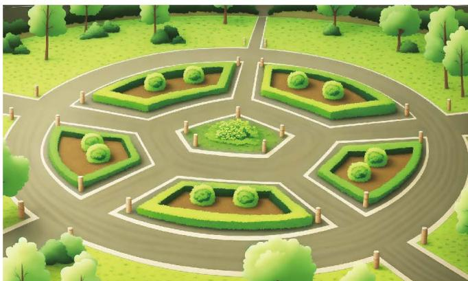
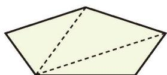
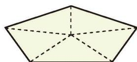

# 由广场五边形边缘分割方法引出多边形内角和公式

## 北师大版初中数学·八年级下册

小明和小亮经常到如图 1-10 所示的广场进行体育锻炼。

图1-10

(1) 这个广场中心的边缘是一个五边形, 你能设法求出它的五个内角的和吗? 与同伴进行交流。

(2) 小明、小亮分别利用图 1-11 和图 1-12 求出了五边形五个内角的和。你知道他们是怎样做的吗？你还有其他的方法吗？

图 1-11

图1-12

