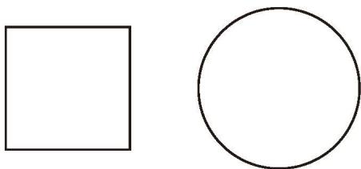

如图 2-1, 用两根长度均为 $l \mathrm{~cm}$ 的绳子分别围成一个正方形和一个圆。

图2-1

(1) 如果要使正方形的面积不大于 $25 \mathrm{~cm}^{2}$ , 那么绳长 $l$ 应满足怎样的关系式?

(2) 如果要使圆的面积不小于 $100 \mathrm{~cm}^{2}$ , 那么绳长 $l$ 应满足怎样的关系式?

(3) 当 $l = 8$ 时, 正方形和圆的面积哪个大? 如果 $l = 12$ 呢? 改变 $l$ 的取值再试一试, 由此你能得到什么猜想?
