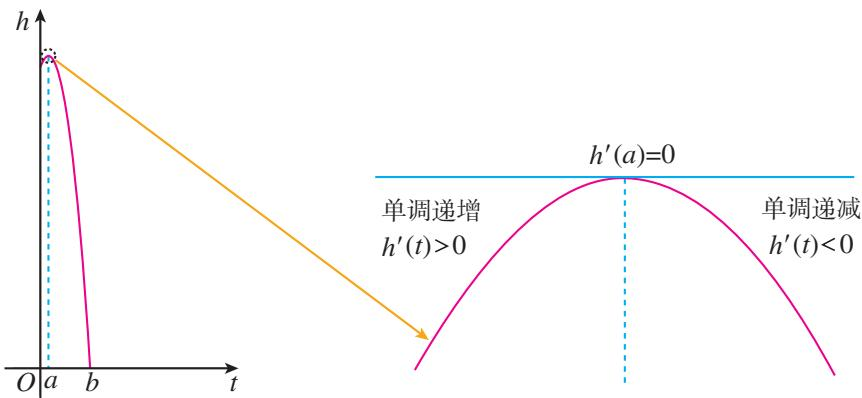
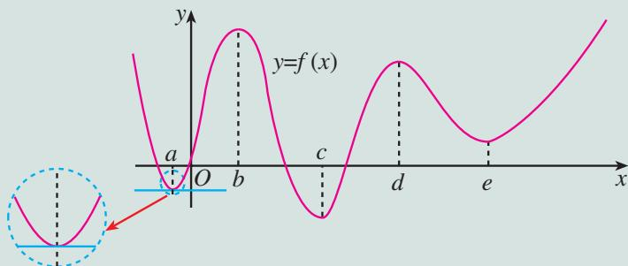

# 由跳水高度最大处认识导数与函数极值

## 高中选择性必修 第二册·人教A版数学

在用导数研究函数的单调性时，我们发现利用导数的正负可以判断函数的增减。如果函数在某些点处的导数为 0，那么在这些点处函数有什么性质呢？

观察图5.3-9，我们发现，当 $t = a$ 时，跳水运动员距水面的高度最大。那么，函数 $h(t)$ 在此点处的导数是多少呢？此点附近的图象有什么特点？相应地，导数的正负性有什么变化规律？

  
图5.3-9  
图5.3-10

放大 t=a 附近函数 $h(t)$ 的图象，如图 5.3-10。可以看出， $h'(a)=0$ ；在 t=a 的附近，当 t<a 时，函数 $h(t)$ 单调递增， $h'(t)>0$ ；当 t>a 时，函数 $h(t)$ 单调递减， $h'(t)<0$ 。这就是说，在 t=a 附近，函数值先增（当 t<a 时， $h'(t)>0$ ）后减（当 t>a 时， $h'(t)<0$ ）。这样，当 t 在 a 的附近从小到大经过 a 时， $h'(t)$ 先正后负，且 $h'(t)$ 连续变化，于是有 $h'(a)=0$ 。

对于一般的函数 $y=f(x)$ ，是否也有同样的性质呢？

探究

如图5.3-11，函数 $y = f(x)$ 在 $x = a, b, c, d, e$ 等点处的函数值与这些点附近的函数值有什么关系？ $y = f(x)$ 在这些点处的导数值是多少？在这些点附近， $y = f(x)$ 的导数的正负性有什么规律？

  
图5.3-11

