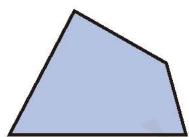
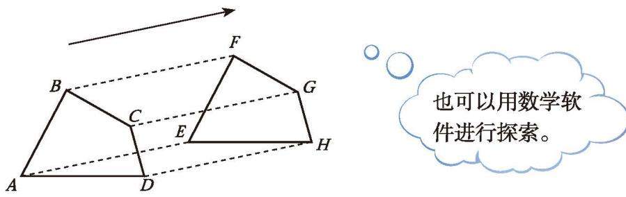

# 硬纸片平移中的对应线段与对应角性质探究

## 北师大版初中数学·八年级下册

> [!question] 操作·思考
> 将图 3-3 所示的四边形硬纸片按某一方向平移一定距离。图 3-4 画出了平移前的四边形 ABCD 和平移后的四边形 EFGH。
>
> （1）在图中任意选一组对应线段，这两条线段之间有怎样的关系？
>
> 
> 图3-3
>
> 
> 图3-4
>
> 也可以用数学软件进行探索。
>
> (2) 在图中任意选一组对应角，这两个角之间有怎样的关系？
>
> (3) 线段 $AE, BF, CG, DH$ 分别是对应点所连成的线段, 它们之间有怎样的关系?
>
> 改变硬纸片的形状，再试一试。

