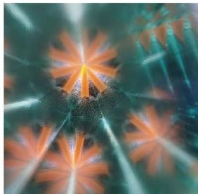
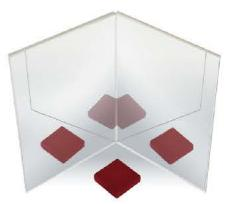
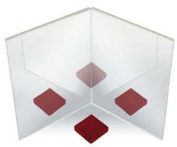
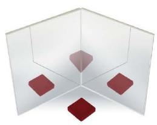
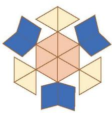
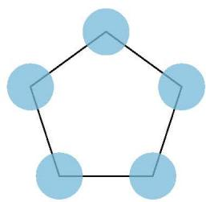

从万花筒中能看到千变万化的绚丽图案，让我们来制作一个万花筒。

万花筒看似简单，其实有很多需要思考的问题。

1. 制作万花筒需要准备哪些材料？

2. 在制作万花筒时, 如果用不同的平面镜去组装, 那么万花筒中看到的像有时就会不完整 (如图 1)。怎样才能保证万花筒中的像都是完整的 “花” 呢? 为此, 可以先将两面镜子的背面用胶带粘贴, 形成一个可以自由开合的 “镜子门”, 通过实验探究 “镜子门” 张角的大小对成像完整性的影响, 进而寻找万花筒成像完整的方法。

图1

3. 组成合作小组，设计制作万花筒的方案。

1. 小组合作进行实验，探究“镜子门”张角的大小对成像完整性的影响，并填写下面的实验报告。

实验目的：探究“镜子门”张角的大小对成像完整性的影响。

实验器材：\_\_\_\_。

操作要点：实验操作要注意安全，观察点应处于“镜子门”的中间位置。

实验过程:

(1) 如图 2、图 3、图 4, 把一个正方形图片放在 “镜子门” 中间, 转动“镜子门”，改变其张角的大小，观察“镜子门”的成像情况。可以发现：当“镜子门”张角为 $90^{\circ}$ 时（如图3），正方形图片与它在镜子中的像共同组成了如图5所示的图形，此时镜子中的像是完整的；而图2、图4镜子中的像是不完整的。请说明为什么会这样。

图2

图3

图4

图5

(2) 将 “镜子门” 垂直放在图 6 上, 调整 “镜子门” 的位置和张角, 使镜子前的图形与镜子中的像共同组成如图 6 所示的图形。你们有几种操作方法?

图6

图7

(3) 如何用类似 (2) 的方式, 使镜子前的图形与镜子中的像共同组成如图 7 所示的图形? 先在图中画一画, 再动手试一试。

(4) 改变图形形状, 继续进行类似 (2)(3) 那样的实验。“镜子门”的张角满足怎样的条件时, 镜子中的像是完整的?

(5) 运用数学方法研究使 “镜子门” 成像完整的方法。

2. 如果用三面镜子制作“镜子门”，那么怎样制作才能使镜子中的像是完整的？先思考设计，再动手实验进行验证。

3. 小组合作制作一个万花筒。

1. 在研究与动手操作的过程中，你经历了怎样的探究过程？

2. 你认为实验过程还可以进行哪些改进？万花筒的制作和使用还可以怎样创新？

展示你们制作的万花筒，并配图辅助说明其中的成像原理。
