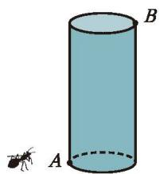
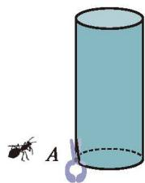
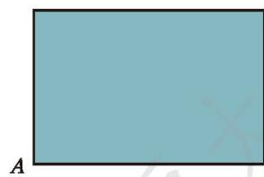

问题 如图 1-19, 一个圆柱的高为 $12 \mathrm{~cm}$ , 底面圆的周长为 $18 \mathrm{~cm}$ 。在圆柱下底面的点 $A$ 处有一只蚂蚁, 它想吃到上底面上与点 $A$ 相对的点 $B$ 处的食物, 那么它沿圆柱侧面爬行的最短路程是多少?

图 1-19

(1) 在这个问题中, 已知条件有哪些? 你认为已知条件足够解决这个问题吗?

(2) 沿侧面爬行的可能路线有哪些? 什么情况下路线最短? 请你用圆柱形水杯等物品实际感受一下。

(1) 以前研究过最短路线问题吗? 这个问题与以前研究的最短路线问题有什么不同?

(2) 如何将曲面上的最短路线问题转化为平面上的最短路线问题? 各个点的位置如何确定?

(1) 如图 1-20, 将圆柱剪开, 确定侧面展开图的形状, 以及与圆柱的对应关系。

(2) 在图 1-20 中标出点 $B$ 的位置。

(3) 在图 1-20 中确定 $A, B$ 两点之间最短的路线，并计算它的长度。

图1-20

(1) 在拟订解决问题的方案和实施方案的过程中, 你获得了哪些经验? 与同伴进行交流。

(2) 这个问题中, 影响结果的量有哪些? 如果改变有关的量, 你还能求解吗? 例如, 改变圆柱的形状, 改变点 $A$ 、点 $B$ 的位置, 改为沿着圆柱表面爬行……这时又会有哪些新的问题? 选择部分问题进行研究, 并与同伴进行交流。

(3) 解决这个问题的经验, 还可以应用到哪些问题中? 例如, 能否解决正方体、长方体等几何体表面两点之间的最短距离问题?

(4) 生活中还有哪些现实问题涉及几何体表面上的最短距离? 举几个实例, 并思考解决问题的方案。

(5) 对于解决问题之后的回顾反思, 你有哪些体会? 与同伴进行交流。
