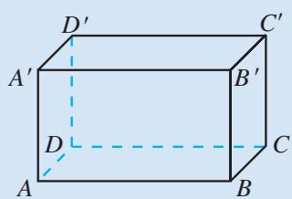

# 观察-长方体中点线面的位置关系

## 高中必修 第二册·人教A版数学

观察

我们知道，长方体有8个顶点，12条棱，6个面。12条棱对应12条棱所在的直线，6个面对应6个面所在的平面。观察如图8.4-11所示的长方体 $ABCD-A'B'C'D'$ ，你能发现这些顶点、直线、平面之间的位置关系吗？

观察你所在的教室，你能找到上述位置关系的一些实例吗？你能再举出一些表示这些位置关系的其他实例吗？

图8.4-11

空间中点与直线的位置关系有两种：点在直线上和点在直线外。如图8.4-11中，点A在直线AB上，在直线 $A^{\prime}B^{\prime}$ 外。空间中点与平面的位置关系也有两种：点在平面内和点在平面外。如图8.4-11中，点A在平面ABCD内，在平面 $A^{\prime}B^{\prime}C^{\prime}D^{\prime}$ 外。

下面我们研究空间中直线、平面之间的位置关系.

