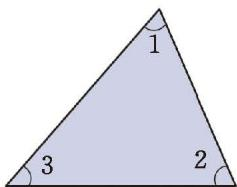
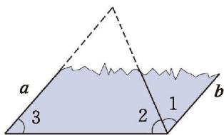

# 观察·交流：剪纸撕角拼合探究三角形内角和

## 北师大版初中数学·七年级下册

> [!question] 观察·交流
> 我们知道，将一个三角形的三个角撕下来，拼在一起，可以得到三角形三个内角的和为 $180^{\circ}$ 。
>
> 小明只撕下三角形的一个角，也得到了上面的结论，他的做法如下。
>
> 如图 4-4, 剪一张三角形纸片, 它的三个内角分别为 $\angle 1$ , $\angle 2$ 和 $\angle 3$ 。将 $\angle 1$ 撕下, 按图 4-5 所示进行摆放, 其中 $\angle 1$ 的顶点与 $\angle 2$ 的顶点重合, 它的一条边与 $\angle 2$ 的一条边重合。
>
> 
> 图4-4
>
> 
> 图4-5
>
> 利用图 4-5，小明说明了三角形三个内角的和为 $180^{\circ}$ 。你知道他是如何说明的吗？说说你的想法，并与同伴进行交流。

