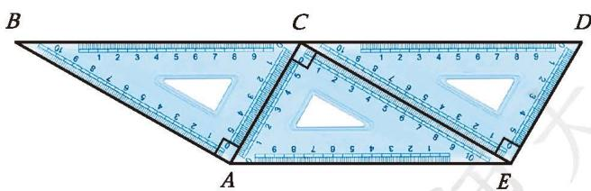

> [!question] 观察·交流
> (1) 如图 2-24, 三个相同的三角尺拼成一个图形, 请找出图中的一组平行线, 并说明你的理由。
>
> 
> 图2-24
>
> (2) 以下是小颖的思考过程, 你能明白她的意思吗?
>
> 
>
> BC 与 AE 是平行的。因为 $\angle BCA$ 与 $\angle EAC$ 是内错角，而且相等。
>
> (3) 在图 2-24 中再找出一组平行线，说说你的理由，并与同伴进行交流。
