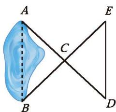

> [!question] 观察·思考
> 如图 4-33, A, B 两点分别位于一个池塘的两端, 小丽想用绳子测量 $A$ , $B$ 间的距离, 但绳子不够长, 一位叔叔帮她出了这样一个主意: 先在地上取一个可以直接到达 $A$ 点和 $B$ 点的点 $C$ , 连接 $AC$ 并延长到 $D$ , 使 $CD = CA$ ; 连接 $BC$ 并延长到 $E$ , 使 $CE = CB$ ; 连接 $DE$ 并测量出它的长度, $DE$ 的长度就是 $A$ , $B$ 间的距离。
>
> 
> 图4-33
>
> 你能说明其中的道理吗？
