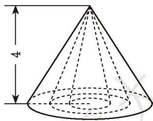

# 观察·思考：圆锥底面半径与体积的关系式变化探究

## 北师大版初中数学·七年级下册

> [!question] 观察·思考
> 如图6-5，圆锥的高是 $4 \mathrm{~cm}$ ，当圆锥的底面半径由小到大变化时，圆锥的体积也随之发生了变化。
>
> (1) 在这个变化过程中, 自变量、因变量各是什么? 当底面半径增大时, 圆锥的体积是如何变化的?
>
> (2) 如果圆锥的底面半径为 $r$ (单位: $\mathrm{cm}$ ), 那么圆锥的体积 $V$ (单位: $\mathrm{cm}^{3}$ ) 如何表示?
>
> 
> 图6-5
>
> （3）在这个变化过程中，取定一个底面半径 $r$ 的值，体积 $V$ 的值能确定吗？

