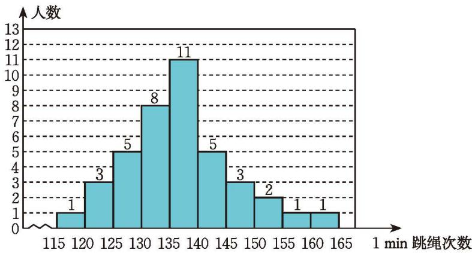
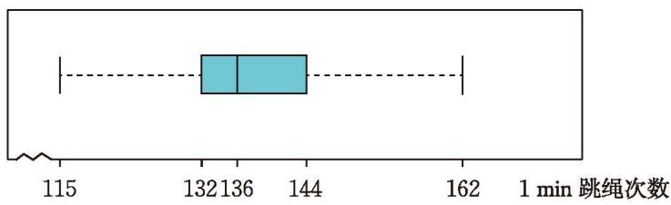

# 观察·思考：对比频数直方图（图6-9）与箱线图（图6-10）反映的数据分布特征

## 北师大版初中数学·八年级上册

> [!question] 观察·思考
> 为了反映全班学生 1 min 跳绳次数的整体情况，小颖和小亮分别画出了图 6-9 和图 6-10。
>
> 
> 图6-9
>
> 
> 图6-10
>
> (1) 在图 6-9 的频数直方图中, 数据的分布有什么特点? 图 6-10 的箱线图是否也反映了数据的这种特征?
>
> (2) 从箱线图中你能获得哪些信息?

