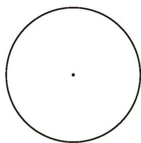
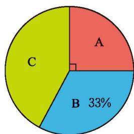

# 观察·思考：根据扇形统计图读取百分比与计算部分数量

## 北师大版初中数学·七年级上册

> [!question] 观察·思考
> 
> 图6-7
>
> 观察图 6-8，回答下列问题：
>
> (1) 如果用整个圆表示总体, 那么哪个扇形表示总体的 $25 \%$ ?
>
> (2) 如果用整个圆表示你们班的人数, 那么扇形 B 大约表示多少人?
>
> 
>
> (3) 如果用整个圆表示 $9 \mathrm{hm}^{2}$ 稻田, 那么扇形 C 表示多少公顷稻田?

