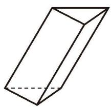
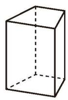
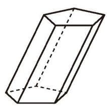
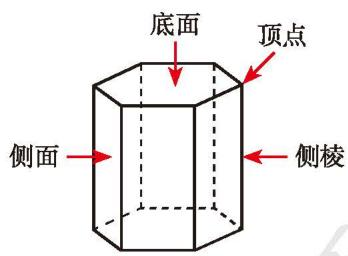

# 观察·思考：棱柱的顶点、侧棱、侧面与底面

## 北师大版初中数学·七年级上册

> [!question] 观察·思考
> (1) 图 1-3 中指出了六棱柱的顶点、侧棱、侧面和底面, 请你指出图中其
>
> 
>
> 三棱柱
>
> 
>
> 四棱柱
>
> 
>
> 五棱柱
> 图1-3
>
> 
>
> 六棱柱
>
> 他棱柱的顶点、侧棱、侧面和底面。
>
> (2)棱柱的侧棱、侧面和底面分别有什么特点?

