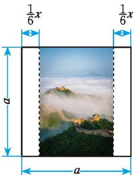
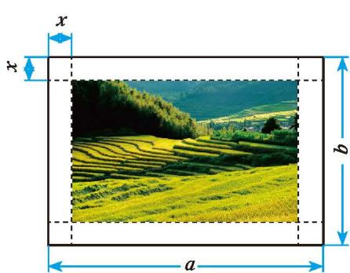

> [!question] 观察·思考
> (1) 如图 1-5, 一幅边长为 $a \mathrm{~m}$ 的正方形风景画, 左右各留有宽为 $\frac{1}{6} x \mathrm{~m}$ 的长方形空白区域作装饰, 中间画面的面积是多少平方米?
>
> 
> 图1-5
>
> 
> 图1-6
>
> (2)如图1-6,一幅长为 $a \mathrm{~m}$ 、宽为 $b \mathrm{~m}$ 的长方形风景画,画面的四周留有空白区域作装饰,其中四角均是边长为 $x \mathrm{~m}$ 的正方形,正中间画面的面积是多少平方米?
