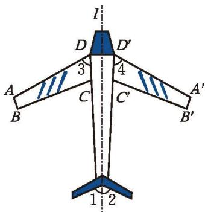

> [!question] 观察·思考
> 图 5-3 是一个轴对称图形，直线 l 是它的对称轴。观察这个图形，回答下列问题：
>
> (1) 在图中任意选一组对应线段, 这两条线段之间有什么关系? 为什么?
>
> (2) 在图中任意选一组对应角, 这两个角之间有什么关系? 说说你的理由。
>
> (3) 连接对应点 $A$ 与 $A'$ , 线段 $AA'$ 与对称轴之间有什么关系? 连接其他任意一组对应点再试一试。
>
> 
> 图5-3
>
