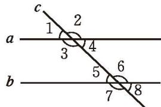

# 观察·探索：平行线截角大小与数量关系实验探究

## 北师大版初中数学·七年级下册

如图 2-28，直线 a 与直线 b 平行。

图2-28

(1) 测量同位角 $\angle 1$ 和 $\angle 5$ 的大小, 它们有什么关系? 图中还有其他同位

角吗？它们的大小有什么关系？改变直线 $c$ 与直线 $a$ 所成角的大小再试一试，你能得到相同的结论吗？

（2）图中有几对内错角？它们的大小有什么关系？为什么？

也可以用数学软件进行探索。

（3）图中有几对同旁内角？它们的大小有什么关系？为什么？

