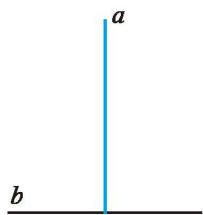
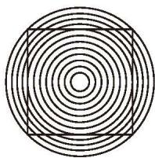
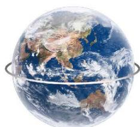

# 视觉错觉与赤道铁丝间隙直觉检验（图7-1至图7-3）

## 北师大版初中数学·八年级上册

以前，我们通过观察、实验、归纳得到了很多正确的结论。观察、实验、归纳得到的结论一定正确吗？我们再感受几个！

(1) 图 7-1 中两条线段 $a, b$ 的长度相等吗? 图 7-2 中的四边形是正方形吗? 请你先观察, 再设法检验你观察到的结论。

图 7-1

图7-2

图7-3

(2) 如图 7-3, 把地球看成球形, 假如用一根比地球赤道长 $1 \mathrm{~m}$ 的铁丝将地球赤道围起来, 铁丝与地球赤道之间的间隙能有多大? 能放进一个拳头吗? 先凭感觉想象一下, 再具体算一算, 看看与你的感觉是否一致, 并与同伴进行交流。

眼睛与直觉有时也会欺骗你哟！

