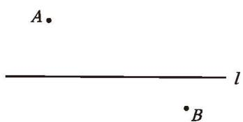

问题 如图 5-23，某工厂计划在一条笔直的道路上设立一个储物点，工作人员每天进入工厂大门后，先到储物点取物品，然后再到车间。你认为该储物点应建在什么地方，才能使工作人员所走的路程最短？

图5-23

如果把大门、车间和储物点所在的位置都看作点，把道路看作一条直线，那么上述问题可以抽象成怎样的数学问题？试着写一写、画一画。

(1) 你以前遇到过类似的问题吗? 关于 “最短”, 你有哪些认识?

(2) 相信你能解决以下问题: 如图 5-24, 直线 $l$ 的两侧分别有 $A$ , $B$ 两点, 在直线 $l$ 上确定一个点 $C$ , 使 $AC + CB$ 最短。原问题与图 5-24 这个问题有什么区别和联系? 你能将原问题转化为图 5-24 这样的问题吗? 说说你的想法。

图5-24

写出你的解决方案，并说明道理。
