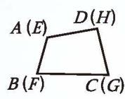
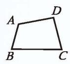
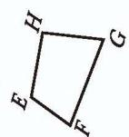

# 透明纸片旋转实验中的线段与角性质探究

## 北师大版初中数学·八年级下册

> [!question] 操作·思考
> 如图 3-13, 两张透明纸上的四边形 $ABCD$ 和四边形 $EFGH$ 完全重合, 在纸上选取旋转中心 $O$ , 并将其固定。把其中一张纸片绕点 $O$ 旋转一定角度 (如图 3-14)。
>
> 
>
> 
> 图3-13
>
> 
> 图3-14
>
> 
>
> (1) 观察图 3-14 中的两个四边形, 你能发现哪些相等的线段和相等的角?
>
> (2) 连接 $AO, BO, CO, DO, EO, FO, GO, HO$ , 你又能发现哪些相等的线段和相等的角?
>
> (3) 在图 3-14 中再取一些对应点, 画出它们与旋转中心所连成的线段,你又能发现什么?
>
> 改变透明纸上所画图形的形状，再试一试。
>
> 也可以用数学软件进行探索。

