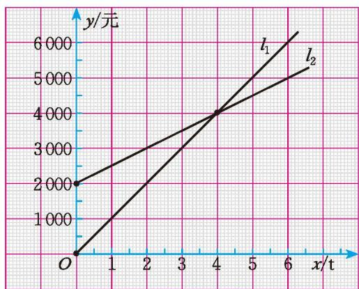

如图 4-10, $l_{1}$ 表示某公司产品的销售收入与销售量之间的关系, $l_{2}$ 表示该公司产品的销售成本与销售量之间的关系。

图4-10

根据图象填空：

(1) 当销售量为 $2 \mathrm{t}$ 时, 销售收入为 元, 销售成本为 元。

(2) 当销售量为 $6 \mathrm{t}$ 时, 销售收入为 元, 销售成本为 元。

(3) 当销售量\_\_\_\_时, 销售收入等于销售成本。

(4) 当销售量 时, 销售收入大于销售成本, 该公司赢利; 当销售量 时, 销售收入小于销售成本, 该公司亏损。

(5) 当销售量为 \_\_\_\_ t 时, 该公司赢利 1000 元。

(6) $l_{1}$ 对应的函数表达式是 $\_\_\_\_$ ， $l_{2}$ 对应的函数表达式是 $\_\_\_\_$ 。

(7) 你能借助 (6) 的结论求解 (5) 吗?
